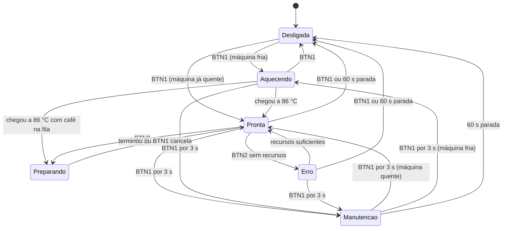

# Cafeteira de cápsula com ESP32

Simulador de uma cafeteira de cápsula em uma PCB ESP32 de 38 pinos, com LEDs, dois botões, potenciômetro e buzzer. O firmware usa ESP-IDF e imita o funcionamento de uma máquina real: aquece o bloco de aquecimento ao ligar, pressuriza a cápsula, extrai o café com vazão realista e desconta água e cápsulas de um estoque salvo na flash.

**Autoria:** Ana Julia Pires Oliveira.

## Hardware

| Periférico | GPIO | Observação |
|---|---:|---|
| LED verde | 17 | Ativo em LOW |
| LED amarelo | 18 | Ativo em LOW |
| LED vermelho | 16 | Ativo em LOW |
| BTN1 | 32 | Pull-down, pressionado em HIGH |
| BTN2 | 33 | Pull-down, pressionado em HIGH |
| Potenciômetro | 34 | ADC1_CH6 |
| Buzzer | 25 | PWM, com transistor BC337 |

Este firmware é exclusivo desta PCB. Gravado na placa original, botões e LEDs podem não responder, porque os GPIOs e as polaridades são diferentes.

## Como compilar e gravar

Requer ESP-IDF 5.5.6. Na raiz do projeto, com o ambiente do ESP-IDF ativo:

```bash
idf.py set-target esp32   # só na primeira configuração
idf.py build
idf.py -p /dev/ttyUSB0 flash monitor
```

Troque `/dev/ttyUSB0` pela porta da placa (no Windows, algo como `COM3`). Para sair do monitor, use `Ctrl + ]`.

## Como usar

| Controle | Função |
|---|---|
| BTN1 curto | Liga e desliga; durante o preparo, cancela; na manutenção, troca entre água e cápsulas |
| BTN2 curto | Inicia o preparo; aquecendo, põe o café na fila ou tira dela; na manutenção, confirma a reposição |
| BTN1 por 3 s | Entra ou sai da manutenção |
| Potenciômetro | Escolhe café curto ou longo; na manutenção, escolhe a quantidade |

A máquina desliga sozinha após 60 s sem uso, exceto enquanto aquece ou prepara um café.

## Estados e LEDs



| Estado | LED |
|---|---|
| Desligada | Todos apagados |
| Aquecendo | Verde piscando devagar; amarelo fixo se houver café na fila |
| Pronta | Verde fixo |
| Preparando | Amarelo piscando |
| Manutenção | Verde piscando (água) ou amarelo piscando (cápsulas) |
| Erro ou falha de memória | Vermelho fixo |

## Simulação baseada em máquinas reais

Os valores ficam em `main/config.h`. A referência é a linha Nespresso Original.

| Parâmetro | Valor | Origem |
|---|---|---|
| Aquecimento a partir do frio | 25 s | Especificação da Essenza Mini ([Nespresso][essenza]); algumas páginas regionais citam 30 s |
| Temperatura de preparo | 86 °C | [FAQ da Nespresso][temperatura] |
| Café curto e longo | 40 mL e 110 mL | [FAQ da Nespresso][volumes] |
| Vazão | 2 mL/s | Estimativa a partir dos tempos típicos de extração |
| Pressurização da cápsula | 5 s | Estimativa |
| Resfriamento desligada | 6 °C por minuto | Estimativa |
| Temperatura ambiente | 25 °C | Suposição |

Com isso, o café curto leva 25 s, dentro da faixa usual de 25 a 30 s para um espresso. O longo leva 60 s. As fontes divergem bastante sobre o lungo (cerca de 30 a 60 s), e 60 s é consequência de manter a mesma vazão nos dois cafés.

Comportamentos que seguem essa lógica:

- **Aquecimento:** como nas máquinas com thermoblock, o que esquenta é o bloco, e a água só passa por ele na hora do café. Por isso, o tempo é de 25 s com qualquer quantidade de água no tanque. O monitor serial mostra uma única linha com a estimativa, e o LED verde pisca até terminar.
- **Fila de preparo:** BTN2 durante o aquecimento agenda o café, que começa sozinho quando a máquina esquenta. O café pedido fica travado, e desligar ou entrar na manutenção esvazia a fila.
- **Religar quente:** a temperatura cai aos poucos com a máquina desligada, então religar logo depois aquece mais rápido. Após 1 minuto desligada, ela leva cerca de 2,5 s em vez de 25 s.
- **Consumo:** a cápsula é descontada ao iniciar e a água, conforme o café sai. Cancelar durante a pressurização gasta a cápsula, mas não a água.
- **Manutenção durante o aquecimento:** o aquecimento continua normalmente, e repor água não muda o tempo.

A temperatura é simulada apenas em função do tempo, pois a placa não tem sensor nem resistência de aquecimento.

## Estoque na memória flash

Água, cápsulas e o indicador de preparo em andamento ficam em um único registro na NVS, então os valores sobrevivem ao reinício. O estoque só muda na RAM depois de gravado com sucesso. Se a gravação falhar, a máquina bloqueia preparo e reposição até ser reiniciada.

Para poupar a flash, a gravação durante o preparo acontece a cada 10 mL (a cada 5 s), o que dá 5 gravações no café curto e 12 no longo. Se a placa reiniciar no meio do preparo, o café é descartado e o erro na conta da água fica limitado a menos de 10 mL.

## Roteiro de demonstração

1. Aperte BTN1 e veja a estimativa de aquecimento no monitor serial, com o LED verde piscando devagar.
2. Aperte BTN2 antes de terminar: o LED amarelo acende, e o café começa sozinho quando a máquina esquenta.
3. Depois, com o verde fixo, escolha o café curto no potenciômetro e aperte BTN2. O café leva 25 s.
4. Prepare outro e aperte BTN1 no meio para cancelar: só a água já usada é descontada.
5. Segure BTN1 por 3 s, reponha água e cápsulas com o potenciômetro e BTN2, e segure BTN1 de novo para sair.
6. Desligue, religue em seguida e veja que a máquina não precisa aquecer tudo de novo.
7. Reinicie a placa e confira que o estoque foi mantido.

O estoque fica salvo entre as gravações, então pode não recomeçar em 600 mL e 3 cápsulas.

## Estrutura do código

| Arquivo | Responsabilidade |
|---|---|
| `main/main.c` | Ponto de entrada e loop principal, a cada 20 ms |
| `main/maquina.c` | Máquina de estados: preparo, manutenção, energia, botões e LEDs |
| `main/aquecedor.c` | Modelo de temperatura do bloco de aquecimento |
| `main/estoque.c` | Leitura e gravação do estoque na NVS |
| `main/perifericos.c` | Acesso a GPIO, ADC e PWM: botões, potenciômetro, LEDs e buzzer |
| `main/config.h` | Pinos, tempos, volumes e demais parâmetros |

Nada no loop principal bloqueia: tempos, melodias e leituras são controlados por comparação com o relógio, então os botões respondem mesmo durante o preparo.

[essenza]: https://nespresso.com/au/en/essenza-mini-coffee-machine
[temperatura]: https://www.contact.nespresso.com/faq/pl/en/detail/817
[volumes]: https://www.contact.nespresso.com/faq/nz/en/detail/1166
